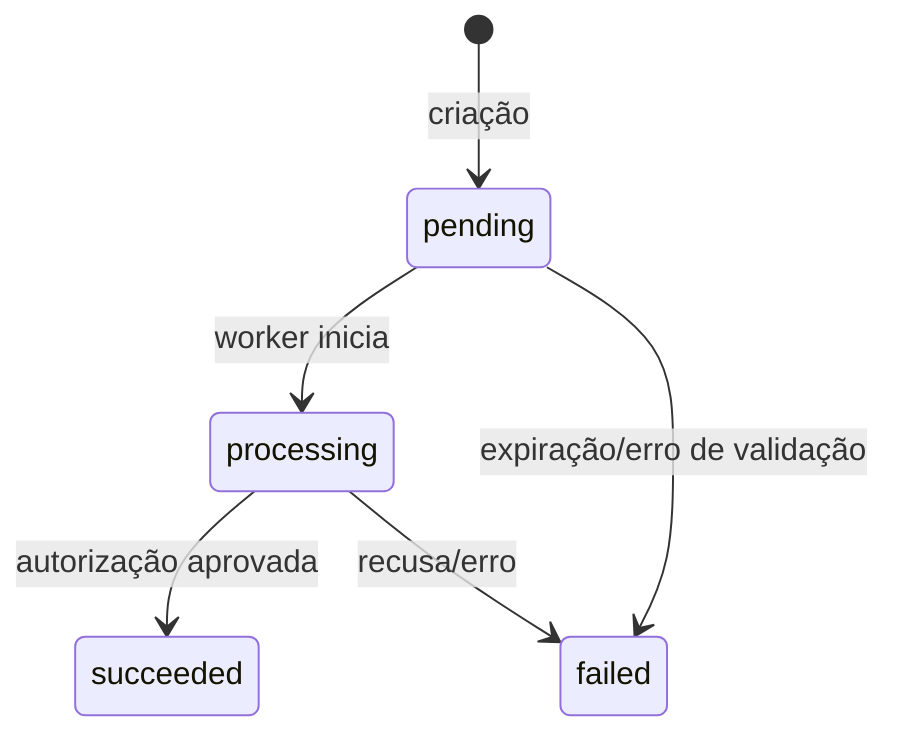

# Especificação Técnica — Gateway de Pagamento Simplificado

| Campo | Valor |
| --- | --- |
| Versão | 0.2 (Aprovada) |
| Status | ✅ Aprovada pelo usuário — Docker incluído |
| Autor | @pm |
| Data | 26/10/2026 |

> **Documento technology-agnostic.** Define comportamento, contratos e restrições — não a stack de implementação, que fica a cargo do @engineer desde que as restrições da seção 8 sejam respeitadas.

---

## 1. Contexto e problema

Comerciantes precisam receber pagamentos por PIX, cartão de crédito e débito sem construir integração com cada adquirente. Este produto entrega um gateway simplificado que:

1. aceita a intenção de pagamento de forma síncrona;
2. processa a cobrança de forma **assíncrona** em fila de mensageria;
3. garante **idempotência** (sem cobrança dupla);
4. notifica o cliente via **webhooks assinados**;
5. é empacotado em **Docker** para subir localmente com um comando.

## 2. Objetivos e métricas de sucesso

- **OBJ-01** — Criar cobrança e responder em < 300 ms (p95), sem bloquear no processamento.
- **OBJ-02** — Zero cobranças duplicadas para a mesma `Idempotency-Key`, comprovado por testes concorrentes.
- **OBJ-03** — 100% das mudanças de status notificadas por webhook assinado, com retry até entrega ou DLQ.
- **OBJ-04** — Rodar localmente (Windows) com um único comando, nativamente **ou** via Docker.

## 3. Escopo

### 3.1 Em escopo (v1)

- API HTTP/JSON para merchants, autenticada por API key.
- Criação de pagamento: **PIX**, **cartão de crédito** e **cartão de débito**.
- Processamento assíncrono via fila de mensageria durável.
- Idempotência de criação (header `Idempotency-Key`) e de consumo (worker).
- Consulta de status do pagamento.
- Webhooks assinados (HMAC-SHA256) com retry, backoff exponencial e DLQ.
- Provedores simulados localmente (sem adquirente real).
- Confirmação simulada de PIX pago (representa o callback do provedor).
- Console web mínimo de demonstração: criar pagamento, acompanhar status e simular PIX pago.
- Empacotamento **Docker**: `Dockerfile` + `docker-compose.yml` para subir a aplicação localmente com um comando.

### 3.2 Fora de escopo (v1)

- Integração com adquirentes/provedores reais.
- Estornos, cancelamentos e chargebacks.
- 3-D Secure, antifraude e análise de risco.
- Multimoeda, assinaturas/recorrência e split de pagamento.
- Painel administrativo completo, relatórios financeiros e conciliação.
- Certificação PCI completa (ver RNF-05).
- Orquestração em cloud/Kubernetes (Docker local apenas).

## 4. Personas

- **Merchant (integrador):** consome a API e recebe os webhooks.
- **Pagador:** consumidor final que paga via PIX ou cartão.
- **Operador (demo):** usa o console local para visualizar o fluxo.

## 5. Jornadas e histórias de usuário

- **US-01** — Como merchant, envio `POST /v1/payments` com PIX e recebo `202` com QR code e txid para exibir ao pagador.
- **US-02** — Como merchant, envio `POST /v1/payments` com cartão e recebo `202` imediatamente; o resultado chega via webhook.
- **US-03** — Como merchant, repito a requisição com a mesma `Idempotency-Key` e recebo exatamente a mesma resposta, sem nova cobrança.
- **US-04** — Como merchant, consulto `GET /v1/payments/{id}` e vejo o status atual.
- **US-05** — Como merchant, recebo webhooks assinados, valido a assinatura e ignoro entregas duplicadas pelo `X-Event-Id`.
- **US-06** — Como operador, simulo o pagamento de um PIX e vejo o status mudar e o webhook ser entregue.
- **US-07** — Como operador, subo todo o sistema com `docker compose up --build` e acesso o console localmente.

## 6. Requisitos funcionais

| ID | Requisito | Prioridade |
| --- | --- | --- |
| RF-01 | Criar pagamento via `POST /v1/payments` com autenticação, validação e `Idempotency-Key` obrigatório. | P0 |
| RF-02 | Processar de forma assíncrona: a API apenas persiste e enfileira; o worker executa. | P0 |
| RF-03 | Idempotência de criação: mesma key + mesmo payload → resposta armazenada; key + payload diferente → `409`. | P0 |
| RF-04 | Idempotência de consumo: mensagens duplicadas não geram efeitos duplicados (CAS de status). | P0 |
| RF-05 | Consultar pagamento por id, restrito ao merchant autenticado. | P0 |
| RF-06 | Webhooks de mudança de status com assinatura HMAC, retry com backoff e DLQ. | P0 |
| RF-07 | Provedores simulados determinísticos: PIX gera QR/txid; cartões aprovam/recusam por números de teste. | P0 |
| RF-08 | Endpoint de confirmação simulada de PIX pago (demo). | P0 |
| RF-09 | Console web mínimo de demonstração. | P1 |
| RF-10 | Listagem paginada de pagamentos do merchant. | P2 |
| RF-11 | Empacotamento Docker: `Dockerfile` + `docker-compose.yml`, build e execução com um comando. | P0 |

## 7. Regras de negócio

- Valores monetários em **centavos (inteiro)**; moeda **BRL**.
- **Máquina de estados:**



- **PIX:** a API gera txid e payload copia-e-cola (EMV simulado) de forma síncrona e determinística (sem chamada externa); o status permanece `pending` até a confirmação (simulada) → `processing` → `succeeded`.
- **Cartão:** dados do cartão **nunca são persistidos**; armazenar apenas bandeira e últimos 4 dígitos. Validar Luhn. Números de teste: `4242 4242 4242 4242` aprova; `4000 0000 0000 0002` recusa; `4000 0000 0000 9995` saldo insuficiente.
- Transições de status são **CAS (compare-and-set)**: só ocorrem a partir do estado esperado.
- Cada transição gera um `payment_event` imutável (histórico/auditoria).
- O webhook é enfileirado **na mesma transação** da mudança de status (padrão outbox), para não perder eventos.

## 8. Arquitetura lógica

```text
Merchant ──HTTP──▶ API (auth, validação, idempotência)
                     │ transação
                     ▼
              Banco relacional (payments, idempotency_keys, outbox)
                     │
                     ▼
              Fila de mensageria durável
                     │ at-least-once
                     ▼
              Worker de pagamentos (idempotente, CAS)
                     │ evento + outbox
                     ▼
              Dispatcher de webhooks (HMAC + retry/backoff)
                     │ HTTPS POST
                     ▼
              Endpoint do merchant
```

**Restrições de arquitetura (obrigatórias):**

- **ARQ-01** — Processamento fora do ciclo request/response (fila).
- **ARQ-02** — Entrega **at-least-once** em toda a cadeia; efeitos **exactly-once** via idempotência.
- **ARQ-03** — Fila **durável**: mensagens sobrevivem a restart. Para execução local, admite-se fila persistida em banco; broker externo (RabbitMQ/Redis) é opcional.
- **ARQ-04** — Worker e dispatcher podem rodar no mesmo processo ou separados, mas são logicamente independentes e reiniciáveis.
- **ARQ-05** — Sem dependência externa obrigatória para rodar localmente (um comando).
- **ARQ-06** — API stateless; estado apenas no banco.
- **ARQ-07** — Empacotamento Docker obrigatório: imagem enxuta (multi-stage build), usuário não-root, `.dockerignore`, healthcheck e `docker-compose.yml` com volume persistente para os dados.

### 8.1 Requisitos de Docker

- `Dockerfile` com **multi-stage build**, imagem final enxuta e execução como **usuário não-root**.
- `.dockerignore` excluindo artefatos desnecessários (`.git`, caches, venv/node_modules quando aplicável).
- **Healthcheck** apontando para um endpoint `/health` da aplicação.
- `docker-compose.yml` com:
  - serviço da aplicação publicado em `http://localhost:<porta>`;
  - variáveis de ambiente vindas de `.env` (API key, segredo de webhook, porta, caminho do banco);
  - **volume nomeado** para persistência dos dados entre restarts;
  - `restart: unless-stopped`;
  - (opcional) serviço de banco de dados, caso a stack escolhida use PostgreSQL.
- `docker compose up --build` deve funcionar em **Windows (Docker Desktop)** sem passos manuais além do build.
- Segredos **não** devem ser embutidos na imagem; somente via ambiente/`.env`.

## 9. Modelo de dados

```text
merchants(id, name, api_key_hash, created_at)

payments(id, merchant_id, amount_cents, currency, method, status, description,
         customer_name, customer_email, metadata,
         pix_txid, pix_qr_code, pix_expires_at,
         card_brand, card_last4, authorization_code, failure_reason,
         created_at, updated_at)

payment_events(id, payment_id, type, payload, created_at)

idempotency_keys(merchant_id, key, request_fingerprint, response_status,
                 response_body, created_at)
  UNIQUE(merchant_id, key)

webhook_endpoints(id, merchant_id, url, secret, active, created_at)

webhook_deliveries(id, endpoint_id, payment_id, event_id, event_type, payload,
                   status, attempts, next_attempt_at, last_response_code, created_at)
  UNIQUE(event_id, endpoint_id)

queue_messages(id, type, payload, status, attempts, available_at, created_at)
```

**Constraints:**

- `payments.status` ∈ {`pending`, `processing`, `succeeded`, `failed`}
- `payments.method` ∈ {`pix`, `credit_card`, `debit_card`}
- `idempotency_keys.response_body` guarda a resposta original para replay idêntico (JSON canônico).
- `webhook_deliveries.status` ∈ {`pending`, `delivered`, `failed`}
- Índices: `payments(merchant_id, created_at)`, `queue_messages(status, available_at)`, `webhook_deliveries(status, next_attempt_at)`.

## 10. Contratos de API

**Autenticação:** `Authorization: Bearer <merchant_api_key>`
**Erros:** `{ "error": { "code": "...", "message": "...", "details": ... } }`

### POST /v1/payments

Headers: `Authorization`, `Idempotency-Key` (obrigatório, 1–255 chars), `Content-Type: application/json`.

```json
{
  "amount": 12990,
  "currency": "BRL",
  "method": "pix | credit_card | debit_card",
  "description": "Pedido #123",
  "customer": { "name": "Ana Silva", "email": "ana@exemplo.com" },
  "card": {
    "number": "4242424242424242",
    "holder": "ANA SILVA",
    "exp_month": 12,
    "exp_year": 2030,
    "cvv": "123"
  },
  "metadata": { "order_id": "ord_123" }
}
```

`card` é obrigatório apenas para cartões e proibido para PIX.

**Respostas:**

- `202 Accepted` — criado: `{ id, status: "pending", method, amount, currency, pix?: { qr_code, txid, expires_at }, created_at }`
- `200 OK` — replay idempotente (mesma resposta + header `Idempotent-Replay: true`)
- `400` — key ausente; `401` — auth inválida; `409` — key reutilizada com payload diferente; `422` — validação.

### GET /v1/payments/{id}

`200` → objeto completo. `404` se não existir ou não pertencer ao merchant.

### POST /v1/payments/{id}/simulate-payment

Confirma um PIX (representa o callback do provedor). Body opcional: `{ "result": "paid" }`. Resposta: `202` → `{ status: "processing" }`. Disponível apenas em ambiente demo.

### GET /v1/payments (P2)

Lista paginada do merchant autenticado.

### Webhooks

**Eventos:** `payment.pending` (PIX), `payment.succeeded`, `payment.failed`.

```json
{
  "id": "evt_...",
  "type": "payment.succeeded",
  "created_at": "2026-10-26T12:00:00Z",
  "data": { "payment": { "id": "pay_...", "status": "succeeded", "amount": 12990 } }
}
```

**Headers:** `X-Event-Id`, `Content-Type: application/json`,
`X-Signature: t=<timestamp>,v1=<hmac_sha256(secret, "<timestamp>.<raw_body>")>`

**Verificação:** recalcular HMAC com o corpo bruto; rejeitar timestamp > 5 min (anti-replay); deduplicar por `X-Event-Id`.

**Retry:** 2xx = sucesso; senão backoff exponencial com jitter (5 tentativas: 10s, 30s, 2min, 10min, 1h); após esgotar → `failed` (DLQ consultável).

## 11. Requisitos não funcionais

- **RNF-01** — Idempotência correta sob concorrência (unique constraint + CAS).
- **RNF-02** — Segurança: API keys hasheadas; HMAC-SHA256 nos webhooks; sem persistência de PAN/CVV; logs sem dados sensíveis; validação de entrada; proteção contra SQL injection.
- **RNF-03** — Resiliência: retries com backoff; timeout de webhook (10s); worker tolerante a crash; mensagens duráveis.
- **RNF-04** — Observabilidade: logs estruturados com request-id, payment-id e event-id; métricas básicas (pagamentos por status, tamanho da fila, entregas de webhook).
- **RNF-05** — Ambiente de demonstração com dados fictícios; nenhum dado real de cartão; PCI formal fora de escopo.
- **RNF-06** — Performance: p95 de criação ≤ 300 ms; processamento assíncrono ≤ 5 s no demo.
- **RNF-07** — Portabilidade: rodar em Windows com um único comando, sem serviços externos obrigatórios — nativamente **ou** via `docker compose up --build`.
- **RNF-08** — Testes automatizados cobrindo idempotência concorrente, máquina de estados, assinatura e retry de webhooks.
- **RNF-09** — Imagem Docker enxuta, não-root, com healthcheck e sem segredos embutidos.

## 12. Critérios de aceitação

- **CA-01** — Mesmo payload + mesma key → 1 cobrança, resposta idêntica, `Idempotent-Replay: true`.
- **CA-02** — Mesma key + payload diferente → `409`, nenhum novo pagamento.
- **CA-03** — N requisições simultâneas com a mesma key → exatamente 1 pagamento criado.
- **CA-04** — Reprocessar a mesma mensagem N vezes → nenhuma transição extra de status.
- **CA-05** — PIX: criação retorna QR/txid; simulação → `succeeded`; webhook `payment.succeeded` entregue com assinatura válida.
- **CA-06** — Cartão recusado (`4000...0002`) → `failed`; webhook `payment.failed`; nenhuma cobrança duplicada.
- **CA-07** — Webhook indisponível → retries com backoff; entrega posterior funciona; tentativas registradas.
- **CA-08** — Body inválido → `422`; sem key → `400`; sem auth → `401`.
- **CA-09** — Reiniciar a aplicação com mensagens pendentes não perde pagamentos nem duplica cobranças.
- **CA-10** — `docker compose up --build` sobe a aplicação e o console em `http://localhost:<porta>`, com dados persistidos em volume entre restarts.

## 13. Premissas e decisões

- **A-01** — Moeda única BRL; valores em centavos.
- **A-02** — Um merchant seed para demonstração; API key via variável de ambiente, documentada no README.
- **A-03** — Provedores simulados; nenhuma chamada externa real.
- **A-04** — Estornos fora do escopo v1.
- **A-05** — Fila durável em banco por padrão; broker externo opcional (interface plugável).
- **A-06** — Stack livre para o @engineer (sugestão: Python/FastAPI + SQLite + worker embutido, ou Node/TypeScript equivalente), desde que RNF-07 seja atendido.
- **A-07** — Um único processo pode hospedar API + worker + dispatcher no demo, com loops independentes.
- **A-08** — Docker é obrigatório no pacote de entrega (`Dockerfile` + `docker-compose.yml`); a execução nativa (sem Docker) também deve funcionar.

## 14. Decisões aprovadas

1. **Stack:** livre para o @engineer (sem preferência imposta).
2. **UI:** console demo mínimo incluído.
3. **Fila:** fila durável em banco por padrão; broker externo opcional.
4. **Estornos:** fora do escopo v1.
5. **Docker:** incluído — `Dockerfile` + `docker-compose.yml` obrigatórios (v0.2).

---

## ✅ Aprovado

Especificação aprovada pelo usuário em 26/10/2026, com a inclusão de Docker (v0.2). O @pm agora aciona: **@engineer → @qa → @devops**.
